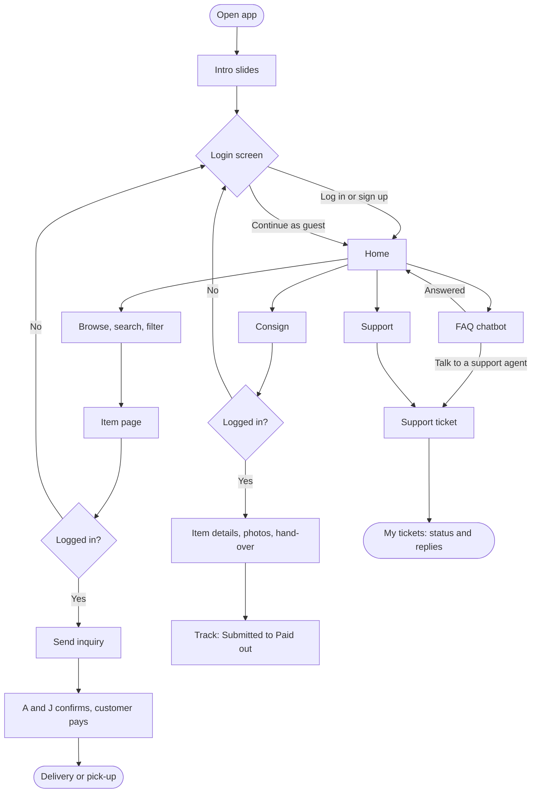
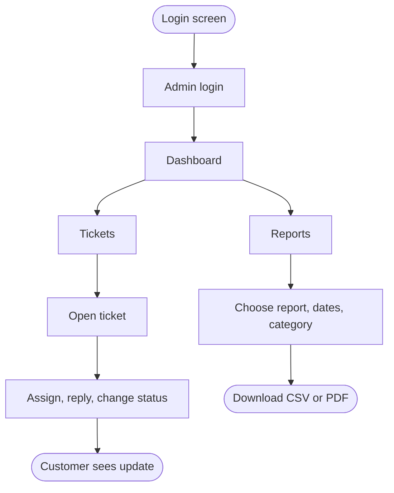

# A&J Luxury Mobile App: Proposed Features and App Flow

**Prepared for:** A&J Luxury owners

**Date:** 23 October 2026

This document has two parts:

1. The features we propose for the A&J Luxury mobile app.
2. A simple walk-through of how the app works, for customers and for A&J staff.

Many of these features can already be tried in our clickable prototypes (Prototypes 2, 3 and 4). The prototypes are demonstrations only. Nothing is saved, there is no real payment, and all items, prices and report numbers are invented sample data. They contain no pictures from the A&J Luxury website.

## How to read the feature tables

- **Core:** we recommend it for the first version of the app.
- **Optional:** useful, but it can wait for a later version.
- **In prototypes:** whether you can try it today. "Yes" means it is in all three prototypes. Otherwise we name the prototype, or say "Not yet" if it is a new proposal.

# Part 1: Proposed Features

## Account and login

| Feature | Description | Benefit to A&J Luxury | Core or optional | In prototypes |
|---|---|---|---|---|
| Guest access | Anyone can browse, search, read FAQs and use the chatbot without an account. | New visitors can explore with no sign-up barrier. | Core | Yes |
| Log in and sign up | Customers create an account with email and password, and can reset a forgotten password. | Serious buyers and consignors are identified, and their history is kept in one place. | Core | Yes |
| Login required for key actions | Saving items, sending inquiries, booking viewings, consigning and opening support tickets ask the person to log in. | A&J knows who it is dealing with before spending staff time. | Core | Yes |
| Saved items | Customers save pieces they like to their account. | Saved items no longer get lost when a customer changes phones, as they can on the website today. | Core | Yes |
| Mobile number check | A code is sent by text message during sign-up. | Fewer fake accounts. | Optional | Prototype 4 (sample only: any 4 digits work, no text is sent) |
| Profile and settings | Customers update their name and contact details, and can turn on dark mode. | Up-to-date contact details for follow-ups. | Optional | Prototype 2 |
| Welcome screens | Three short intro slides on first launch, which can be skipped. | Explains buy, consign and authenticity in seconds. | Optional | Yes |

## Shopping

| Feature | Description | Benefit to A&J Luxury | Core or optional | In prototypes |
|---|---|---|---|---|
| Catalogue by category | Items are grouped into bags, shoes, small leather goods and other categories, plus brand-new and pre-loved. | Familiar layout, close to the website's. | Core | Yes |
| Search and filters | Search by keyword, and filter by brand, condition and price. | Customers find the right piece faster. | Core | Yes |
| Item page | Swipeable photo gallery with pinch-to-zoom, condition rank, flaws, inclusions and price. | Buyers can inspect condition closely, which builds trust and can reduce disputes. | Core | Yes |
| Inquire on an item | The customer picks how to be contacted (Viber, WhatsApp, Messenger, Instagram or a phone call), plus a payment method and a delivery option. | Every inquiry arrives with the same details, linked to the item. | Core | Yes |
| Inquiry tracker | Shows each inquiry's stage: Inquiry sent, A&J replies, Payment, then Delivery or pick-up. | Fewer "any update?" messages. | Core | Yes |
| Showroom viewing booking | The customer picks a day, a time of day and the pieces they want to see. | A&J can prepare the right items before the visit. | Optional | Prototype 3 |
| Layaway planner | Shows the 30% down payment and estimated monthly payments for an item. | Makes the layaway offer easy to understand. No interest is shown, because the website gives no rate. | Optional | Prototype 4 |
| Brand directory and Discover cards | Browse by brand, or swipe through items one at a time. | Encourages browsing and repeat visits. | Optional | Prototypes 3 and 4 |
| In-app payment | Pay inside the app by GCash, card or bank transfer. | Faster sales with less manual follow-up. Needs a payment provider account, and the app must stay in sync with the website so one item is not sold twice. | Optional | Not yet (prototypes use inquiry, then payment arranged by A&J) |
| New-arrival and price-drop alerts | Phone notifications about new pieces, or about price changes on saved items. | Brings buyers back quickly, which matters because most pieces are one of a kind. | Optional | Not yet (Prototype 4 has in-app notices only) |

## Consignment and selling

| Feature | Description | Benefit to A&J Luxury | Core or optional | In prototypes |
|---|---|---|---|---|
| Consignment request | A guided form for item details, photos, condition and hand-over (drop-off or courier). | Replaces the form the website's Consign page mentions but does not have. Every request arrives complete. | Core | Yes (a different layout in each prototype) |
| Consignment tracker | Shows each item's stage: Submitted, Received, Authenticated, Listed, Sold, then Paid out. | Consignors can see progress without messaging staff. | Core | Yes |
| Sell-for-cash request | A request form for customers who want A&J to buy their item outright. | Covers A&J's sell-to-us service in the app. | Core | Not yet (only the chatbot explains it) |
| Guided photo checklist | The app asks for each required photo in turn (front, back, hardware, serial or date code, flaws, inclusions). | Better photos at intake, so appraisals are faster. | Optional | Not yet (prototypes add a drawn sample instead of a real photo) |
| Consignment terms in the app | Terms, period, pull-out fee and payout rules are shown before the consignor submits. | Fewer misunderstandings later. These terms must be confirmed by A&J. | Core | Yes (through the chatbot and FAQ) |

## Help and support

| Feature | Description | Benefit to A&J Luxury | Core or optional | In prototypes |
|---|---|---|---|---|
| FAQ chatbot | Answers questions about how to buy, consign, sell for cash, payout, shipping, payment, layaway, the authenticity process, returns, condition ratings and the showroom. | Answers common questions at any hour, with the same approved answer each time. It never says whether an item is authentic or fake. | Core | Yes |
| Talk to a support agent | When the chatbot can't help, it opens a support ticket with the chat attached. | Customers don't repeat themselves, and staff see the full question. | Core | Yes |
| Support tickets (technical support and after-sales) | The customer reports an order issue, a return or refund request, an authenticity concern or an app problem, and links it to the order or consignment. | Every issue gets a reference number, a timestamp and an owner, which helps with the 24-hour return window. | Core | Yes |
| My tickets | Ticket list with status (Open, In progress, Resolved), a timeline, replies, and the option to reopen. | Customers see progress, and both sides have a clear record. | Core | Yes |
| Searchable FAQs | A list of FAQ answers the customer can search. | A self-help option for people who prefer reading. | Optional | Prototype 2 |
| Authenticity guide | Explains how A&J authenticates items. | Builds trust. The content must come from A&J. | Optional | Prototype 3 (general guide only; A&J's step-by-step process is still to be provided) |
| Notifications inside the app | Alerts when a ticket or request is updated. | Customers know when to check back. | Optional | Prototype 4 |

## Admin (A&J staff only)

| Feature | Description | Benefit to A&J Luxury | Core or optional | In prototypes |
|---|---|---|---|---|
| Separate admin login | Staff sign in through their own login screen, and customers cannot open admin pages. | Keeps business data private. | Core | Yes (one sample staff account) |
| Dashboard | Shows sales, orders, new users, consignments, open tickets, average resolution time, chatbot questions and escalations, each compared with the previous period. | The health of the business on one screen. | Core | Yes |
| Ticket queues | Staff view, search, assign, reply to, change the status of, close and reopen tickets. Each change is shown to the customer. | Several staff can share the work without losing track of customers. | Core | Yes |
| Reports and analytics | Sales, consignment, support and user reports by date range and category, with charts, CSV download and PDF. | Shows which categories sell, what customers ask and how fast support responds. | Core | Yes |
| Top chatbot topics | Shows what customers ask the chatbot most. | Helps A&J improve FAQs, policies and marketing. | Core | Yes |
| Team view | Each staff member's active and resolved tickets. | Balances workload across the team. | Optional | Yes |
| Inquiry and consignment handling | Staff update inquiry and consignment stages, such as Received, Authenticated, Listed and Paid out. | The customer trackers stay accurate. | Core | Not yet |
| Listing management | Add, edit and mark items as sold. | One catalogue for the app and the website. Whether this is done in the app's admin or in A&J's existing Shopify store is still to be decided. | Core | Not yet |
| Staff roles and permissions | Different access levels for owners, support staff and authenticators. | Each person sees only what they need. | Core | Not yet |

# Part 2: Simple App Flow

## Customer flows

### 1. Opening the app and logging in

1. Open the app. First-time users see three short intro slides, which they can skip.
2. On the login screen, choose **Log in**, **Sign up**, or **Continue as guest**.
3. The Home screen opens. Guests can browse, search and use the chatbot. Other actions ask them to log in.

### 2. Browsing and buying an item

1. From **Home** or **Shop**, pick a category, or use search and filters.
2. Open an item to see its photos, condition, flaws, inclusions and price.
3. Tap **Save** to keep it for later, or **Inquire** to buy. Both need a login.
4. Choose a contact method, a payment method and delivery or pick-up, then send the inquiry.
5. A&J confirms the item is available and sends payment details. The customer pays and receives the item.
6. The customer follows each step in the inquiry tracker.

In-app payment is not in the prototypes. It is listed as an optional feature.

### 3. Consigning an item

1. Open **Consign** and log in.
2. Enter the item details, add photos, describe the condition, and choose drop-off or courier.
3. Submit the request and receive a reference number.
4. Follow the consignment tracker: Submitted, Received, Authenticated, Listed, Sold, Paid out.

### 4. Getting help from the FAQ chatbot

1. Open **Help**. It is named Help, Concierge or Ava, depending on the prototype design.
2. Tap a topic or type a question.
3. Read the answer, and tap a suggested next step if one is offered.
4. If the answer doesn't help, tap **Talk to a support agent**. A support ticket opens with the chat attached.

### 5. Getting after-sales or technical support

1. Open **Support** and log in.
2. Tap **New ticket** and choose the type: order issue, return or refund, authenticity concern, or app problem.
3. Pick the related order or consignment, then add a subject and description.
4. Submit the ticket and receive a reference number.
5. Check **My tickets** for status updates and staff replies, and reply if needed.

## Admin flow (A&J staff)

### 6. Logging in as admin

1. On the login screen, tap **Admin login**.
2. Sign in with a staff account. The dashboard opens.

### 7. Handling support tickets

1. Open **Tickets**, or start from **Needs attention** on the dashboard.
2. Open a ticket to see the customer, the linked order or consignment, and any chat history.
3. Assign the ticket, reply, and change the status to In progress or Resolved.
4. The customer sees the update in **My tickets**.

### 8. Viewing reports and analytics

1. On the **Dashboard**, choose a period: 7 days, 30 days, 90 days or 12 months.
2. Open **Reports** and pick a report type: sales, consignments, support tickets or users.
3. Filter by date range and category.
4. Download the report as CSV, or save it as PDF.

## Flow diagram: customers

## Flow diagram: admin

## Things to confirm or still unknown

- **Policies:** shipping fees, the card fee (4% or 5%), return rules, consignment terms and the showroom address differ between pages of the current website. A&J needs to confirm them before the chatbot and the app use them.
- **Payment:** which payment provider A&J would use for in-app payment has not been decided.
- **Website link:** how the app and the Shopify website share one catalogue has not been designed yet. It matters because most items are one of a kind.
- **Staff setup:** the prototypes have one sample staff account. Real staff accounts, roles and response times need A&J's input.
- **Phone alerts:** real push notifications and text messages are not built yet.
- **Chatbot:** the prototype chatbot matches keywords to fixed answers. It is not an AI model, and every answer must be approved by A&J.
- **Testing:** the prototypes have been tested in the Chromium browser only, not yet on a real phone, Safari or Firefox.
