# Sitemap and Navigation Reference: A&J Luxury

> Part of the [website blueprint](website_blueprint.md). Source: <https://aandjluxury.com/>. Observed **2026-10-09**.

## Coverage statement (read first)

This sitemap is **based on discovered, publicly accessible pages only**. It is built from (1) the store's published `sitemap.xml` and its child sitemaps, (2) every link found in the header, mobile menu, footer, homepage and the pages fetched, and (3) the URLs the store itself documents in [`/agents.md`](https://aandjluxury.com/agents.md). It does **not** claim to cover hidden, unlinked, admin or authenticated routes.

Not visited on purpose (robots.txt `Disallow`, or account/payment areas): `/cart/*`, `/checkout*`, `/checkouts/*`, `/orders*`, `/account*` (except the allowed `/account/login`, which was only checked for an HTTP status), `*sort_by*` crawl URLs, multi-filter URLs and `/recommendations/products`. Adding to cart, checkout and sign-in were **not** exercised.

| Discovery source | Count |
|---|--:|
| URLs in `sitemap.xml` children | 996 (971 product, 9 page, 12 collection, 1 blog, 1 article, 1 agents.md, 1 homepage) |
| Products in the live JSON feed (`/collections/all/products.json`) | 991 (the sitemap lags: the 20 newest products are absent from it) |
| Collections | 12 (3 are empty: Scents, Clothing, Sale) |
| Pages in sitemap | 9 (**3 return 404**) |

Raw lists: [`datasets/sitemap_urls.csv`](datasets/sitemap_urls.csv), [`datasets/pages.csv`](datasets/pages.csv), [`datasets/collections.csv`](datasets/collections.csv).

## 1. Hierarchical sitemap

Legend: ✅ 200 and populated · ⚪ 200 but empty · ❌ 404 / no response · 🔗 reachable only by direct URL or sitemap (no inbound navigation link found in the fetched pages)

```text
https://aandjluxury.com/                                  ✅ Home
├── Header menu (desktop and mobile drawer)
│   ├── HOME                                              -> /
│   ├── SHOP  (dropdown, href="#")
│   │   ├── Bags                                          -> /collections/bags                ✅ 702 products
│   │   ├── Shoes                                         -> /collections/shoes               ✅ 114
│   │   ├── Small Leather Goods                           -> /collections/wallets             ✅ 116  (page H1: "Wallets and Small Leather Goods"; called "SLGs" elsewhere)
│   │   ├── Scents                                        -> /collections/scents              ⚪ "Sorry, there are no products in this collection"
│   │   └── All Products                                  -> /collections/all-products        ✅ 985
│   ├── SALE                                              -> /collections/sale                ⚪ empty
│   ├── BRAND NEW                                         -> /collections/brand-new           ✅ 35
│   ├── CONSIGN/SELL  (dropdown, href="#")
│   │   ├── Consign                                       -> /pages/consign                   ✅
│   │   └── Sell                                          -> /pages/sell                      ✅
│   └── CUSTOMER SERVICE  (dropdown, href="#")
│       ├── About Us                                      -> /pages/about-us                  ✅
│       ├── FAQs                                          -> /pages/faqs                      ✅
│       └── Visit Us                                      -> /pages/visit-us                  ✅
├── Header icons
│   ├── Search (overlay, predictive)                      -> /search/suggest (AJAX) -> /search?q=…   ✅
│   ├── Account                                           -> /account                         (not exercised; robots.txt)
│   └── Wishlist                                          -> /pages/wishlist                  ❌ 404  (the real page is /pages/wish-list)
├── Home sections
│   ├── Hero slideshow (3 slides)                         -> /collections/bags · /collections/shoes · /collections/wallets
│   ├── Featured Collection tabs                          -> New Arrivals (/collections/new-arrivals) · Bags · Shoes · SLGs (/collections/wallets)
│   ├── Category tiles                                    -> BAGS (/collections/bags) · SLGs (/collections/wallets) linked; SHOES, WATCHES, ACCESSORIES not linked
│   ├── "Sell or Consign with Us!"                        -> /pages/consign
│   ├── Story panel ("art of bliss")                      -> /pages/about-us
│   ├── Testimonials (5)                                  (no links)
│   └── Benefit strip (4 icons)                           (no links)
├── Footer
│   ├── QUICK LINKS
│   │   ├── Home                                          -> /
│   │   ├── Shop                                          -> /collections/all-products
│   │   ├── Brands                                        -> https://a-and-j-luxury.myshopify.com/shop-by-brand   ❌ unverified host (see issue 3); same path on the primary domain is 404
│   │   ├── About Us                                      -> /pages/about-us
│   │   ├── FAQs                                          -> /pages/faqs
│   │   └── Customer Reviews                              -> /pages/customer-reviews          ❌ 404
│   ├── CATEGORIES: Bags · Clothing (⚪ empty) · Shoes · SLGs · All Products
│   └── FOLLOW US: tel:+639277537322 · mailto:info@aandjluxury.com · Facebook · Instagram · WhatsApp (external)
├── Collections (12)
│   ├── /collections/bags · /wallets · /shoes · /all-products · /new-arrivals · /pre-loved · /brand-new      ✅
│   ├── /collections/pre-order (6 products)               ✅ 🔗
│   ├── /collections/watches (1 product)                  ✅ 🔗
│   └── /collections/scents · /clothing · /sale           ⚪ empty
│       └── Product pages  /products/{handle}  (991 products; 971 in sitemap)   ✅
├── Pages (sitemap_pages)
│   ├── /pages/about-us · /pages/faqs · /pages/consign · /pages/sell · /pages/visit-us        ✅
│   ├── /pages/wish-list                                  ✅ 🔗 (empty state is "No products were added to the wishlist page.")
│   └── /pages/brands · /pages/shop-by-brand · /pages/customer-reviews                         ❌ 404 (listed in sitemap)
├── Blog
│   ├── /blogs/news                                       ✅ 🔗 (1 article)
│   └── /blogs/news/main-account-disabled                 ✅ (article dated Jun 14, 2022)
├── Policies
│   └── /policies/refund-policy                           ✅ 🔗 (text identical to the FAQ return policy)
├── Search
│   ├── /search?q={query}                                 ✅
│   └── /collections/vendors?q={Brand}                    ✅ (target of the product page "Brand:" link)
├── Account / cart (not exercised)
│   ├── /account/login · /account/register · /account     robots.txt: only /account/login is Allowed
│   └── /cart · cart drawer                               robots.txt: /cart/ Disallowed
└── Machine-readable / agent endpoints
    ├── /robots.txt · /sitemap.xml (+ 6 child sitemaps)
    ├── /agents.md · /.well-known/ucp · /api/ucp/mcp (documented by the store; not called)
    └── /collections/{handle}/products.json · /products/{handle}.json   (documented read-only endpoints in agents.md)
```

## 2. Navigation table

"Entry point" = where a visitor can click to reach the page. "Key functions" were verified in a real browser unless marked otherwise (see the verification column in the [blueprint](website_blueprint.md#7-feature-and-function-inventory)).

| Page | URL | Parent section | Entry point | Key functions |
|---|---|---|---|---|
| Home | `/` | Root | Logo, HOME, footer Home | Hero slideshow, Featured Collection tabs, category tiles, promo panels, testimonials slider, benefit strip |
| Bags | `/collections/bags` | Shop | SHOP > Bags; hero slide 1; BAGS tile; Featured tab "Bags"; footer Categories; collection sidebar | Filter sidebar (brand, product type, colour, condition rank, price, availability), sort, grid-density toggle, pagination (20 per page, 36 pages) |
| Shoes | `/collections/shoes` | Shop | SHOP > Shoes; hero slide 2; Featured tab "Shoes"; footer | Same collection tooling (114 products, 6 pages) |
| Small Leather Goods | `/collections/wallets` | Shop | SHOP > Small Leather Goods; hero slide 3; SLGs tile; Featured tab; footer ("SLGs") | Same (116 products, 6 pages) |
| Scents | `/collections/scents` | Shop | SHOP > Scents | Empty-state message |
| All Products | `/collections/all-products` | Shop | SHOP > All Products; footer Shop / All Products | Same (985 products, 50 pages) |
| Sale | `/collections/sale` | Top level | SALE | Empty-state message |
| Brand New | `/collections/brand-new` | Top level | BRAND NEW; sidebar "Condition > Brand New" | Same (35 products, 2 pages) |
| New Arrivals | `/collections/new-arrivals` | Collections | Featured tab "New Arrivals" > SHOP COLLECTION | Same (985 products; membership equals All Products) |
| Pre loved | `/collections/pre-loved` | Collections | Sidebar "Condition > Preloved" | Same (956 products, 48 pages) |
| Clothing | `/collections/clothing` | Collections | Footer Categories; sidebar | Empty-state message |
| Pre-order | `/collections/pre-order` | Collections | None found (sitemap only) | 6 products |
| Watches | `/collections/watches` | Collections | None found (home WATCHES tile is not linked) | 1 product |
| Product | `/products/{handle}` | Collections | Any product card, search result, predictive-search result | Gallery with thumbnails and zoom modal, wishlist heart, details accordions, Viber / WhatsApp inquiry links, sticky add-to-cart bar, recently viewed |
| Consign | `/pages/consign` | Consign/Sell | CONSIGN/SELL > Consign; home "Read more"; Sell page button | Informational; "VIBER US" button; links to Sell |
| Sell | `/pages/sell` | Consign/Sell | CONSIGN/SELL > Sell; Consign page "HOW TO SELL" | Informational; links to Consign |
| About Us | `/pages/about-us` | Customer Service | CUSTOMER SERVICE > About Us; home story "Read more"; footer | Informational |
| FAQs | `/pages/faqs` | Customer Service | CUSTOMER SERVICE > FAQs; footer | 9 expandable Q&A items |
| Visit Us | `/pages/visit-us` | Customer Service | CUSTOMER SERVICE > Visit Us | Address area, map link, hours, Viber, social links |
| Wish List | `/pages/wish-list` | Pages | **No working link** (header icon points at `/pages/wishlist`, 404) | Lists items stored in the visitor's browser |
| News | `/blogs/news` | Blog | None in header/footer (sitemap; article breadcrumb) | Article list |
| Article | `/blogs/news/main-account-disabled` | Blog | News list | Share links (Facebook, Pinterest, Twitter) |
| Refund policy | `/policies/refund-policy` | Policies | None found (documented in `/agents.md`) | Policy text |
| Search results | `/search?q={q}` | Utility | Header search; predictive-search "Results for" / suggestion links | Product results |
| Vendor listing | `/collections/vendors?q={brand}` | Utility | Product page "Brand:" link | Lists a brand's products |
| 404 | any missing URL | Utility | n/a | "Oops! Page not found!" and **Go to Home** |

## 3. Navigation flow (Mermaid)

```mermaid
flowchart TD
    Home["Home /"]
    Home --> Shop["SHOP menu"]
    Home --> Sale["SALE /collections/sale (empty)"]
    Home --> BN["BRAND NEW /collections/brand-new"]
    Home --> CS["CONSIGN/SELL menu"]
    Home --> Cust["CUSTOMER SERVICE menu"]
    Home --> Search["Search overlay"]
    Home --> Wish["Wishlist icon -> /pages/wishlist (404)"]
    Shop --> Bags["Bags"]
    Shop --> Shoes["Shoes"]
    Shop --> SLG["Small Leather Goods /collections/wallets"]
    Shop --> Scents["Scents (empty)"]
    Shop --> All["All Products"]
    CS --> Consign["Consign /pages/consign"]
    CS --> Sell["Sell /pages/sell"]
    Consign <--> Sell
    Cust --> About["About Us"]
    Cust --> FAQ["FAQs"]
    Cust --> Visit["Visit Us"]
    Bags --> PDP["Product page /products/handle"]
    Shoes --> PDP
    SLG --> PDP
    All --> PDP
    BN --> PDP
    Search --> PDP
    Search --> Results["/search?q="]
    Results --> PDP
    PDP --> Brand["/collections/vendors?q=Brand"]
    PDP --> Viber["Viber inquiry (external)"]
    PDP --> WA["WhatsApp inquiry (external)"]
    PDP --> Cart["Add to cart (not exercised)"]
    Home --> Tabs["Featured tabs"]
    Tabs --> NewA["/collections/new-arrivals"]
    Tabs --> Bags
    Tabs --> Shoes
    Tabs --> SLG
    Home --> Hero["Hero slides"]
    Hero --> Bags
    Hero --> Shoes
    Hero --> SLG
    Home --> Promo["Sell or Consign panel"]
    Promo --> Consign
    Home --> Story["Story panel"]
    Story --> About
    Home --> Footer["Footer"]
    Footer --> Brands["Brands (myshopify.com, no response)"]
    Footer --> Reviews["Customer Reviews (404)"]
    Footer --> Social["Facebook / Instagram / WhatsApp (external)"]
```



## 4. External links

| Link | Where it appears | Type | Observed |
|---|---|---|---|
| `https://www.facebook.com/ajluxuryph/` | Footer, Visit Us, JSON-LD `sameAs` | Social | Not followed |
| `https://instagram.com/shopwithaandj` | Footer, Visit Us, JSON-LD `sameAs` | Social | Not followed |
| `https://wa.me/639152345968` | Footer; product pages use `https://wa.me/+639152345968` | WhatsApp deep link | Not followed |
| `viber://chat?number=+639277537322` | Product pages ("Inquire on Viber") | Viber deep link | Not followed |
| `tel:+639277537322`, `mailto:info@aandjluxury.com` | Footer | Phone / email | n/a |
| `https://maps.app.goo.gl/PjbRczJUrrEGHG4t5` | Visit Us "Get Direction" | Google Maps short link | Not followed |
| `https://www.cookiesandyou.com/` | Cookie banner "Learn more" (hidden for this visitor) | Third-party info site | Not followed |
| `https://a-and-j-luxury.myshopify.com/shop-by-brand` | Footer "Brands" | **Internal Shopify domain, path has no `/pages/` prefix** | Unreachable from the test network (connection reset); behaviour unverified |
| `https://www.facebook.com/sharer/…`, `pinterest.com/pin/create/…`, `twitter.com/intent/tweet` | Article share buttons | Share intents | Not followed |
| `https://www.svgrepo.com/show/…` (4 SVGs) | Homepage benefit strip images | Third-party image host | Loaded by the page (hotlinked) |
| `https://shop.app/SKILL.md`, `https://ucp.dev` | Referenced only in `robots.txt` / `agents.md` | Agent documentation | Not part of the storefront UI |

## 5. Navigation issues observed

| # | Issue | Evidence | Impact |
|---|---|---|---|
| 1 | Header **Wishlist icon links to `/pages/wishlist`, which returns 404**; the working page is `/pages/wish-list`. | HTTP 404 vs 200; header HTML `href="/pages/wishlist"` | Visitors who click the heart land on "Page not found". The wishlist page itself has no inbound link. |
| 2 | Footer **"Customer Reviews"** links to `/pages/customer-reviews` (404). The page is also listed in the sitemap. | HTTP 404 | Dead footer link on every page. |
| 3 | Footer **"Brands"** links to `https://a-and-j-luxury.myshopify.com/shop-by-brand` (internal Shopify host, and no `/pages/` prefix). `/pages/brands` and `/pages/shop-by-brand` are in the sitemap but both return 404. | The `myshopify.com` host **could not be reached from the test network** (connection reset in both curl and Chromium; `cdn.shopify.com` was reset the same way, so this is probably an environment limit, not proof the link is dead for everyone). The same path on the primary domain, `https://aandjluxury.com/shop-by-brand`, returns **404**. | No working brand directory is linked. The link's actual behaviour for other visitors is **unverified**. |
| 4 | **Three empty collections are in primary navigation**: Scents (SHOP menu), Sale (top-level menu), Clothing (footer and sidebar). | "Sorry, there are no products in this collection" | Empty destinations in the main menu. |
| 5 | Homepage **category tiles SHOES, WATCHES, ACCESSORIES are not clickable**. | No ancestor `<a href>` in the DOM | Dead-end tiles; the Watches collection (1 product) and Pre-order collection (6) have no inbound links. |
| 6 | **`sitemap.xml` is stale** by 20 products compared with the live product feed: the missing ones are exactly the 20 newest (created 2026-10-08 21:40 to 22:02 +08:00). | 971 vs 991 handles | Newest products are missing from the sitemap (SEO). |
| 7 | **Two aliases for the full catalogue**: `/collections/all` (991 incl. 6 unavailable) and `/collections/all-products` (985). The wishlist empty state links to `/collections/all`; menus link to `/all-products`. | JSON feeds | Inconsistent entry points. |
| 8 | Blog (`/blogs/news`) and refund policy (`/policies/refund-policy`) have no header/footer links. | Link audit of fetched pages | Reachable only by URL or sitemap. |
| 9 | Consign and Sell pages say "Fill out our consignment form" / "fill out the form", but **no form or link to one exists** on either page. | No `<form>`, `<iframe>` or link in the page HTML; confirmed visually in [`consign_desktop.png`](assets/screenshots/consign_desktop.png) | Primary call to action is missing; users must use Viber/WhatsApp. |

## 6. Redirect behaviour

No redirects were observed on any tested URL (`redirects=0` for `/`, `/collections/all`, `/collections/all-products`, `/policies/refund-policy`, `/search?q=gucci`, `/pages/*`, `/cart`). Missing paths return a real **HTTP 404** with the themed "Oops! Page not found!" page ([`not-found_desktop.png`](assets/screenshots/not-found_desktop.png)). Localization (`?country=…`) was not exercised; the homepage sets a `localization=PH` cookie from the visitor's IP.
